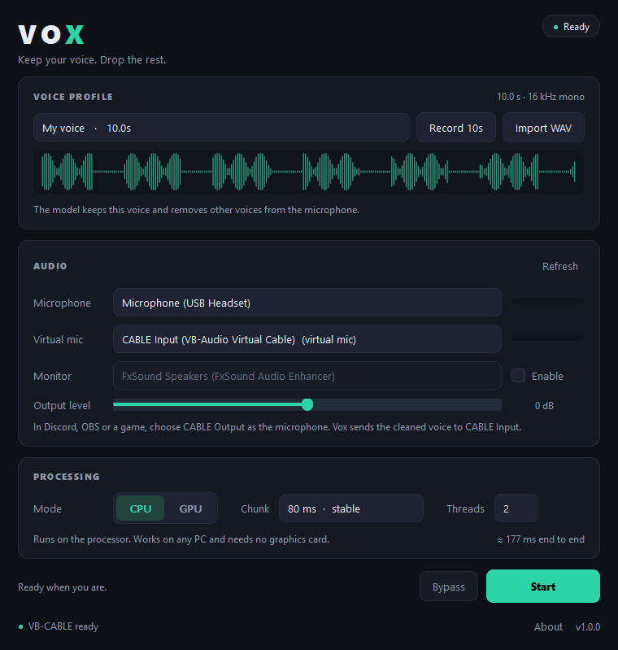

# Vox

Real-time voice isolation for Windows. Vox keeps the voice it was enrolled on
and removes everyone else, then feeds the result to a virtual microphone so
Discord, OBS, Zoom, or a game receives only you.

Built on the open-source [VoxLock](https://github.com/arbazsiddiqui/voxlock)
speaker-extraction model, with a native desktop UI and a one-click installer.



## What it does

```
 microphone ──► Vox ──► CABLE Input ──► (virtual cable) ──► CABLE Output ──► Discord / OBS / game
                  │
                  └─ optional monitor to your headphones
```

You record or import a clean sample of your own voice once. From then on Vox
compares every 80 ms block of microphone audio against that sample and keeps
the matching speaker, so a TV, a roommate, or a second person at the desk is
removed before the audio reaches the call.

Everything runs locally. No account, no cloud, no telemetry, no network access
after installation.

## Requirements

- Windows 10 2004 (build 19041) or Windows 11, 64-bit.
- A microphone. Any WASAPI capture device works.
- [VB-CABLE](https://vb-audio.com/Cable/) for the virtual microphone. The
  installer offers to download it; it needs a driver install with admin
  rights, which Vox itself does not need.
- GPU mode: any DirectX 12 capable GPU (NVIDIA, AMD, or Intel). No CUDA or
  cuDNN installation is needed.
- CPU mode: a reasonably modern quad-core. An AVX2 CPU helps a lot.

## Install

1. Download `Vox-1.0.0-setup.exe` from
   [Releases](https://github.com/DetectiveLon/Vox/releases).
2. Run it. It installs for the current user in `%LOCALAPPDATA%\Programs\Vox`,
   so it does not ask for admin rights.
3. If VB-CABLE is not installed yet, leave the "Download VB-CABLE" task
   checked. Finish that installer with the default options, then reboot if it
   asks you to.
4. Start Vox, open **Record 10s**, and speak normally in your own voice.

No Python, no drivers, no model download: the installer contains the app and
the model files.

### Set up Discord, OBS, or a game

In Vox, set **Output** to `CABLE Input (VB-Audio Virtual Cable)`.

Then, in the app that should hear you, select the matching capture device:

| App | Setting | Choose |
| --- | --- | --- |
| Discord | Voice & Video → Input Device | `CABLE Output (VB-Audio Virtual Cable)` |
| OBS | Audio → Mic/Auxiliary → Device | `CABLE Output` |
| Zoom / Teams | Microphone | `CABLE Output` |
| Game voice chat | Input device | `CABLE Output` |

Leave Vox's **Microphone** on your real microphone. Do not select `CABLE
Output` there or you create a loop.

If you also want to hear yourself, enable **Monitor** in Vox and pick your
headphones. Without it you hear nothing from Vox, which is normal.

## How to use it

1. **Voice profile.** Record 10 seconds or import a WAV/FLAC/OGG file with one
   voice and little background noise. 10-15 seconds is ideal; 3 seconds is the
   minimum and more than 30 is ignored.
2. **Microphone and Output.** Pick your real microphone and `CABLE Input`.
3. **Start.** The status turns to `Live`. Speak, and watch the output meter.
4. **Bypass** sends the raw microphone through untouched, for comparison.
5. **Gain** trims the isolated output from -12 to +12 dB if the result is
   quieter or louder than the raw microphone.

Vox remembers devices by name, so unplugging a headset does not break the
setup; it falls back to the system default and reconnects when the device
returns.

## CPU and GPU modes

| Mode | Model | Measured speed on Ryzen 5 3600 / RTX 2060 |
| --- | --- | --- |
| GPU | fp16, DirectML | 80 ms block in about 18 ms (RTF 0.23) |
| CPU | int8, ONNX Runtime CPU | 80 ms block in about 52 ms (RTF 0.66) |

RTF is processing time divided by audio time; lower is better and anything
below 1.0 keeps up in real time. GPU mode is roughly three times faster here,
but it needs a working DirectX 12 driver and a few seconds on the first start
while DirectML compiles the graph. CPU mode starts faster and uses no VRAM.

**Chunk size.** 80 ms is the default and the most stable. 40 ms halves the
added delay and still works on both modes on this machine (GPU RTF 0.51, CPU
RTF 0.81), but it leaves less headroom on slower CPUs. Change it while Vox is
stopped.

**Threads** applies to CPU mode only. Two threads is the default; four can help
on a CPU with spare cores, and one leaves room for a game.

End-to-end delay is roughly the chunk size plus inference plus about 30-50 ms
of device and cable buffering, so around 130-160 ms in GPU mode at 80 ms. That
is fine for conversation and acceptable for most games, not for monitoring
your own voice while singing.

## Command line

```powershell
# Verify a build without opening the window
& "$env:LOCALAPPDATA\Programs\Vox\Vox.exe" --selftest --mode cpu --result "$env:TEMP\vox.json"

# Same check forcing GPU mode
& "$env:LOCALAPPDATA\Programs\Vox\Vox.exe" --selftest --mode gpu --threads 2

# Process a real recording instead of the synthetic test signal
& "$env:LOCALAPPDATA\Programs\Vox\Vox.exe" --selftest --input call.wav --profile me.wav --result out.json
```

The JSON result contains `ok`, `rtf`, `block_ms`, `output_rms`, and the model
folder in use. Exit code is 0 when the check passes.

## Build from source

Requirements: Windows, Python 3.11 64-bit, [Inno Setup 6](https://jrsoftware.org/isinfo.php)
for the installer, and about 3 GB of free disk during the build.

```powershell
git clone https://github.com/DetectiveLon/Vox.git
cd Vox

py -3.11 -m venv .venv
.\.venv\Scripts\python -m pip install -r requirements-dev.txt
.\.venv\Scripts\python -m pip install --no-deps voxlock==1.3.0

# Model files are not stored in git; this downloads the pinned revision
.\.venv\Scripts\python tools\fetch_models.py

# Run from source
.\.venv\Scripts\python -m voxapp

# Headless check
.\.venv\Scripts\python -m voxapp --selftest --mode cpu

# Package: PyInstaller onedir, frozen self-test, then the Inno Setup installer
powershell -ExecutionPolicy Bypass -File installer\build.ps1

# Optional: install the result silently, run it, and uninstall it again
powershell -ExecutionPolicy Bypass -File installer\test-install.ps1
```

Output:

- `dist\Vox\` is the portable app folder; `dist\Vox\Vox.exe` runs without the
  installer.
- `installer\Output\Vox-1.0.0-setup.exe` is the single-file installer.
- `installer\Output\SHA256SUMS.txt` lists checksums.

`installer\build.ps1 -SkipTests` skips the test suite and `-NoInstaller` stops
after the portable build. The version lives in `voxapp\__init__.py`,
`installer\version.iss`, and `installer\version_info.txt`; the build refuses to
start when those three disagree.

## Repository layout

| Path | Contents |
| --- | --- |
| `voxapp/engine.py` | Audio capture, inference worker, output writers, fixed-shape DirectML path |
| `voxapp/ui.py` | Main window, recording dialog, meters |
| `voxapp/devices.py` | WASAPI discovery and stable device keys |
| `voxapp/profiles.py` | Voice profile record, import, save, validation |
| `voxapp/settings.py` | JSON settings |
| `voxapp/selftest.py` | Headless verification used by CI and the installer test |
| `models/` | Downloaded model files (not in git) |
| `installer/` | Inno Setup script, build script, VB-CABLE helper |
| `tools/fetch_models.py` | Downloads and verifies the pinned model files |
| `tests/` | Unit tests |

Settings live in `%APPDATA%\Vox\settings.json`, voice profiles in
`%APPDATA%\Vox\profiles`, and logs in `%LOCALAPPDATA%\Vox\logs`. The app writes
no registry keys.

## Uninstall

Use **Settings → Apps → Vox → Uninstall**. The uninstaller removes the app and
asks, once, whether to delete your voice profiles and settings too. VB-CABLE is
a separate product and is left installed; remove it from the same Apps list if
you no longer need it.

## Troubleshooting

**No output device / no VB-CABLE.** Install VB-CABLE from
<https://vb-audio.com/Cable/>, reboot, then press **Refresh** in Vox.

**GPU button is disabled.** The DirectML provider is missing or the GPU driver
does not expose DirectX 12. Update the GPU driver, or use CPU mode. A remote
desktop session can also hide the GPU; try a local session.

**First start takes several seconds.** DirectML compiles the graph on the first
run. Later starts are faster. The status pill shows `Loading` while this
happens.

**The other voice leaks through.** Re-record the profile in the microphone you
actually use, alone, without music or a fan, and keep the first 10 seconds
clean. A profile recorded on a headset still works on a different microphone,
but a clean one works better.

**Your own voice sounds thin or drops out.** The model needs a few seconds of
speech to lock on. If you are quiet or far from the microphone, raise the input
level in Windows, or switch to 80 ms chunks.

**Crackling or dropouts.** Check the `RTF` figure in Vox. Above 0.9 the machine
is close to the limit: use 80 ms chunks, close heavy background apps, or switch
to GPU mode. Also make sure no other application is holding the microphone in
exclusive mode.

**The app starts but the call hears nothing.** Confirm that Vox shows `Live`,
that its output is `CABLE Input`, and that the call app uses `CABLE Output` as
its microphone. Windows Settings → System → Sound shows whether the cable is
receiving audio.

Logs are in `%LOCALAPPDATA%\Vox\logs`; **Open log folder** in the About dialog
takes you there.

## License and credits

Vox is MIT licensed. The voice model and inference code are VoxLock by Arbaz
Siddiqui, Apache-2.0, derived from the REAL-TSE WeSep baseline. Full
attribution is in [THIRD_PARTY_NOTICES.md](THIRD_PARTY_NOTICES.md) and in the
installed `models\LICENSE` and `models\NOTICE` files.
